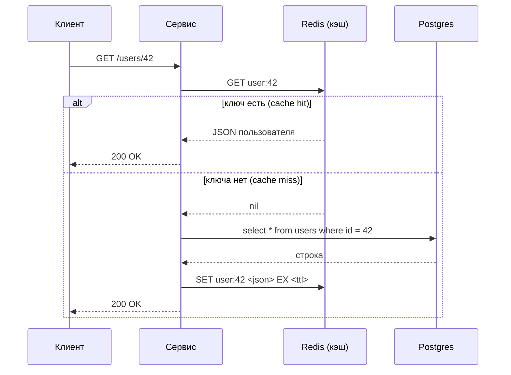

# Паттерн Cache-aside

## Идея в одном предложении

Приложение само решает, когда читать из кэша и когда в него писать. Кэш при этом ничего не знает о базе, а база ничего не знает о кэше. Поэтому паттерн и называется «кэш сбоку» (cache-aside). Ещё его называют **lazy loading** («ленивая загрузка»): данные попадают в кэш только тогда, когда их кто-то запросил.

## Чтение



По шагам:

1. Сервис спрашивает кэш по ключу (`user:42`).
2. Если ключ есть (**попадание**, cache hit), ответ возвращается сразу, база не трогается.
3. Если ключа нет (**промах**, cache miss), сервис идёт в базу, кладёт результат в кэш с ограниченным временем жизни (**TTL**, time to live) и отвечает клиенту.

В этой лабе всё это сделано в [UserService.kt](../code/app/src/main/kotlin/by/famcs/usersapi/UserService.kt), в методе `getUser`: шаг 1 — строки 50–57, шаг 2 — строки 59–62, шаг 3 — строки 64–74.

## Запись

Это не про нашу лабу (у нас только чтение), но для полноты картины. При изменении данных в cache-aside обычно делают так:

1. записать новое значение в базу;
2. **удалить** ключ из кэша (`DEL user:42`), а не перезаписать его.

Следующее чтение получит промах и подтянет свежие данные. Удаление надёжнее перезаписи: если два параллельных запроса обновляют одну запись, при перезаписи в кэше может остаться старое значение.

## Чем отличается от других паттернов

| Паттерн | Кто ходит в базу при чтении | Кто пишет в кэш | Коротко |
|---|---|---|---|
| **Cache-aside** | сервис | сервис, после промаха | самый распространённый, кэш можно выключить без изменения базы |
| Read-through | кэш сам (у него есть «загрузчик») | кэш | сервис общается только с кэшем |
| Write-through | — | кэш при каждой записи, синхронно с базой | кэш всегда свежий, запись медленнее |
| Write-behind (write-back) | — | кэш, а в базу пишет позже пачками | быстрая запись, риск потерять данные |

## Плюсы

- **Простота.** Логика кэша — это десяток строк в одном месте кода.
- **В кэше только нужное.** Попадают лишь записи, которые реально запрашивают. Редкие записи кэш не занимают.
- **Отказ кэша — не отказ сервиса.** Если Redis недоступен, сервис может пойти напрямую в базу. Медленнее, но работает (в нашем коде так и сделано: `catch` на строках 53–57).

## Минусы и риски

- **Первый запрос всегда медленный.** У пустого кэша («холодного») все запросы — промахи. Поэтому перед тестом кэш **прогревают**: заранее запрашивают все id.
- **Данные могут устареть.** Пока не истёк TTL, кэш отдаёт старую версию, если кто-то изменил базу в обход сервиса.
- **Шторм промахов (cache miss storm, cache stampede).** Кэш внезапно опустел: его очистили, перезапустили или массово истёк TTL. Тогда весь поток запросов, который раньше гасился кэшем, одновременно идёт в базу. А база рассчитана только на ту долю запросов, что раньше проходила мимо кэша. Это и моделируется в пятом задании лабы.

## Как защищаются от шторма промахов

| Приём | Что делает | Есть в лабе? |
|---|---|---|
| Разброс TTL (jitter) | к TTL добавляется случайные ±10%, чтобы ключи, положенные одновременно, не истекли в одну секунду | да, `ttlWithJitter()` |
| Прогрев кэша | перед нагрузкой (или после перезапуска Redis) все горячие ключи загружаются заранее | да, `jmeter/warmup.jmx` |
| Таймаут на Redis | если кэш завис, сервис не ждёт его вечно (у клиента Lettuce по умолчанию 60 секунд) | да, 200 мс в `application.yml` |
| Single-flight / блокировка | при промахе в базу идёт только один запрос за ключом, остальные ждут его результат | нет |
| Stale-while-revalidate | отдаём устаревшее значение, пока один поток в фоне обновляет кэш | нет |
| Ограничение нагрузки на базу | пул соединений (у нас Hikari на 10 соединений) не даёт открыть к базе тысячи соединений | да, по умолчанию |
| Circuit breaker («предохранитель») | при множестве ошибок Redis на время перестаём к нему обращаться | нет |

## Шпаргалка по Redis для этой лабы

```bash
docker exec -it lab2-redis redis-cli                  # консоль redis внутри контейнера
```

Внутри консоли:

```
GET user:42          # значение по ключу (nil, если нет)
TTL user:42          # сколько секунд ключу осталось жить
DBSIZE               # сколько ключей в базе
INFO stats           # статистика, в т.ч. keyspace_hits / keyspace_misses
FLUSHALL             # удалить ВСЕ ключи во всех базах redis — так моделируется «кэш опустел»
```

- `FLUSHALL` — сам Redis жив и отвечает, но все ключи пропали. Каждый запрос становится промахом, пока кэш снова не наполнится.
- `docker stop lab2-redis` — Redis выключен целиком. Клиент получает ошибку соединения. В нашей настройке Redis запускается без записи на диск, поэтому после `docker start` он тоже пустой.
