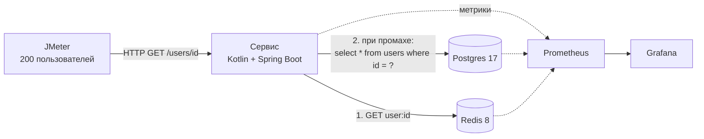
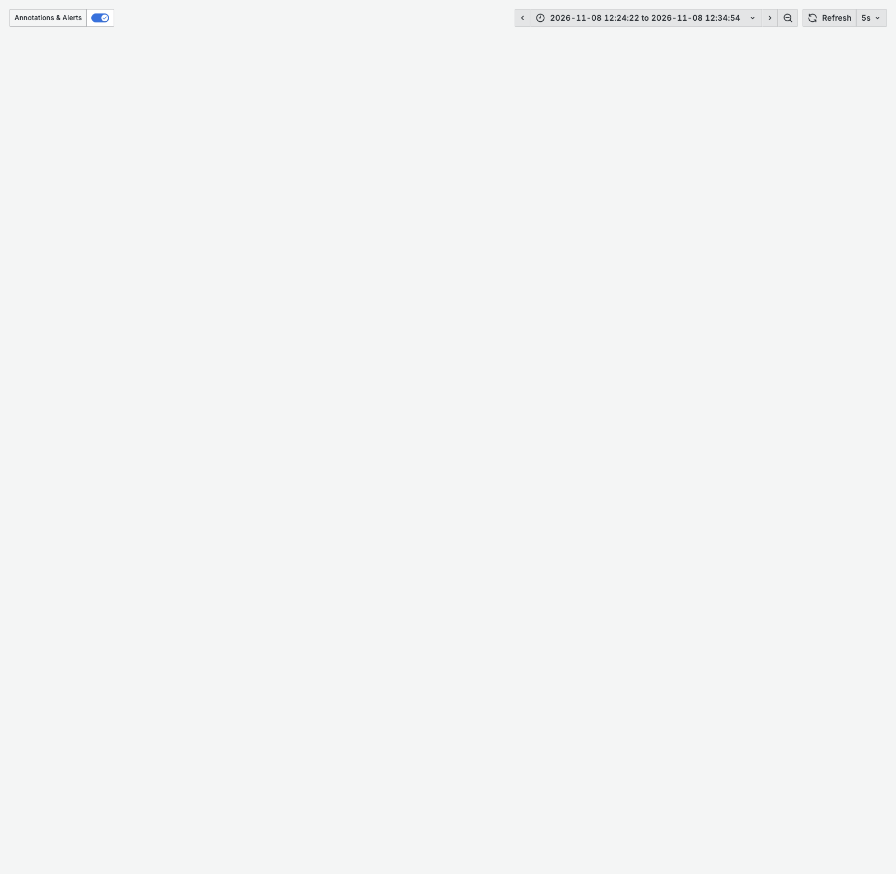
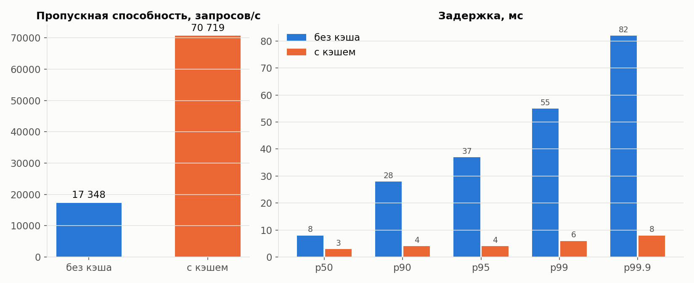
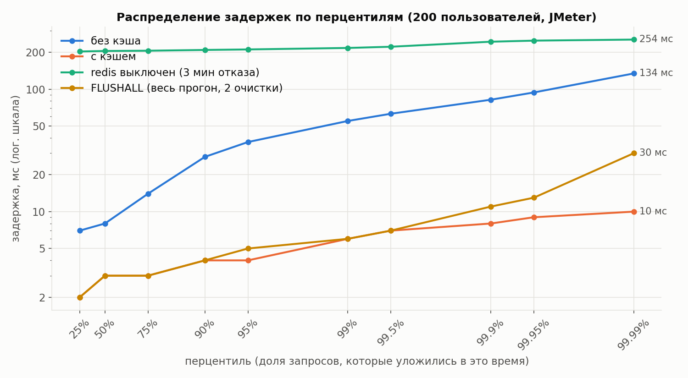
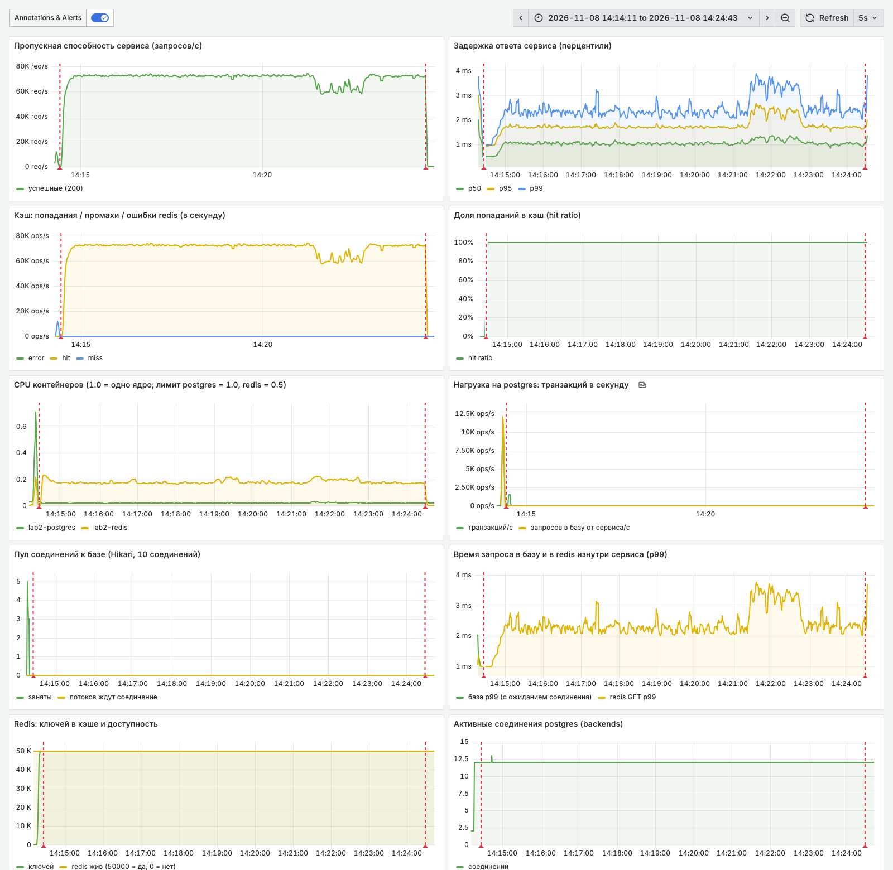
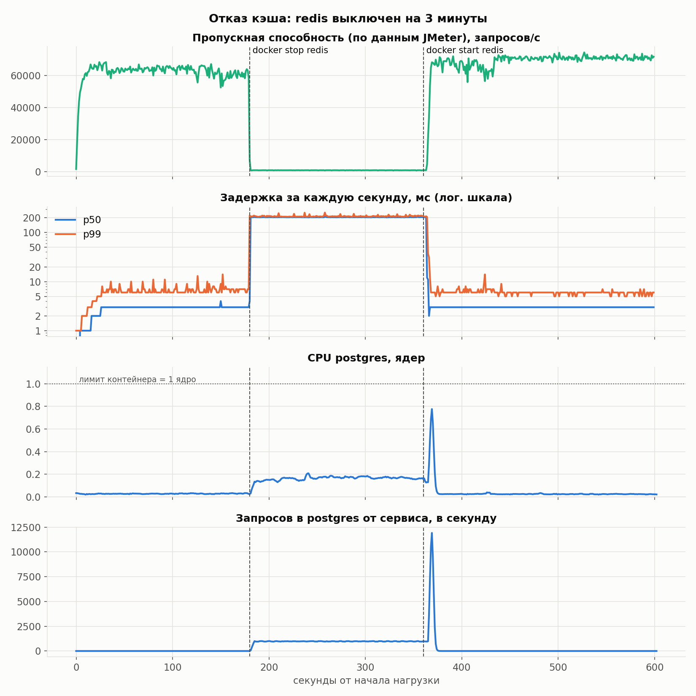
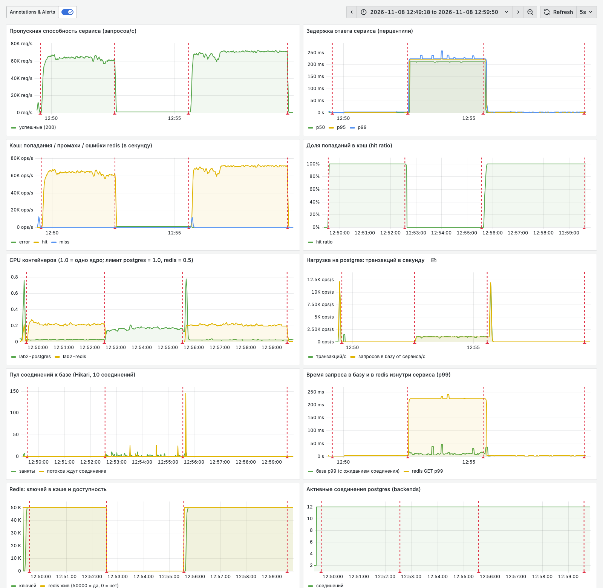
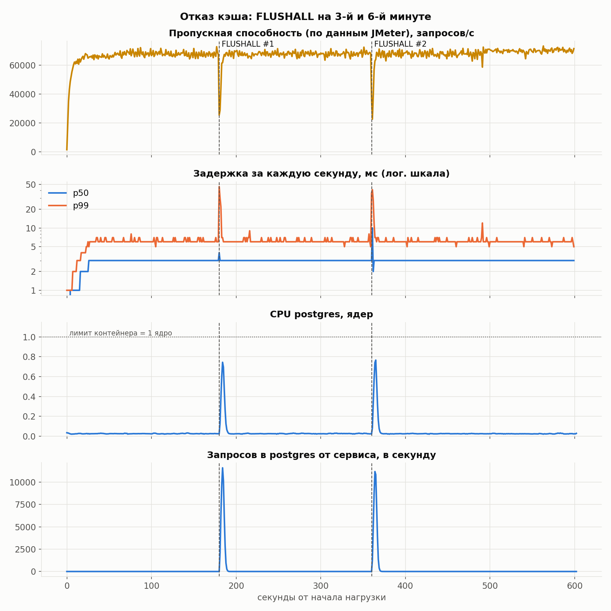
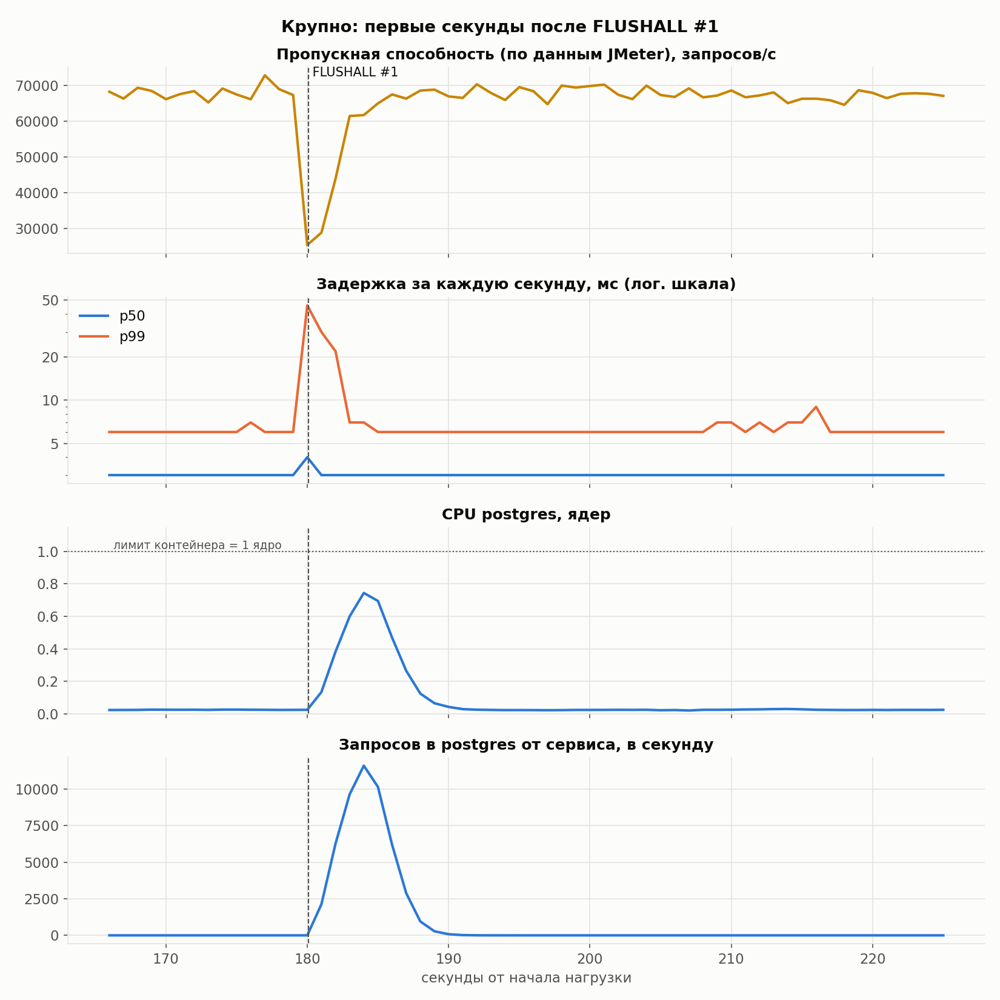
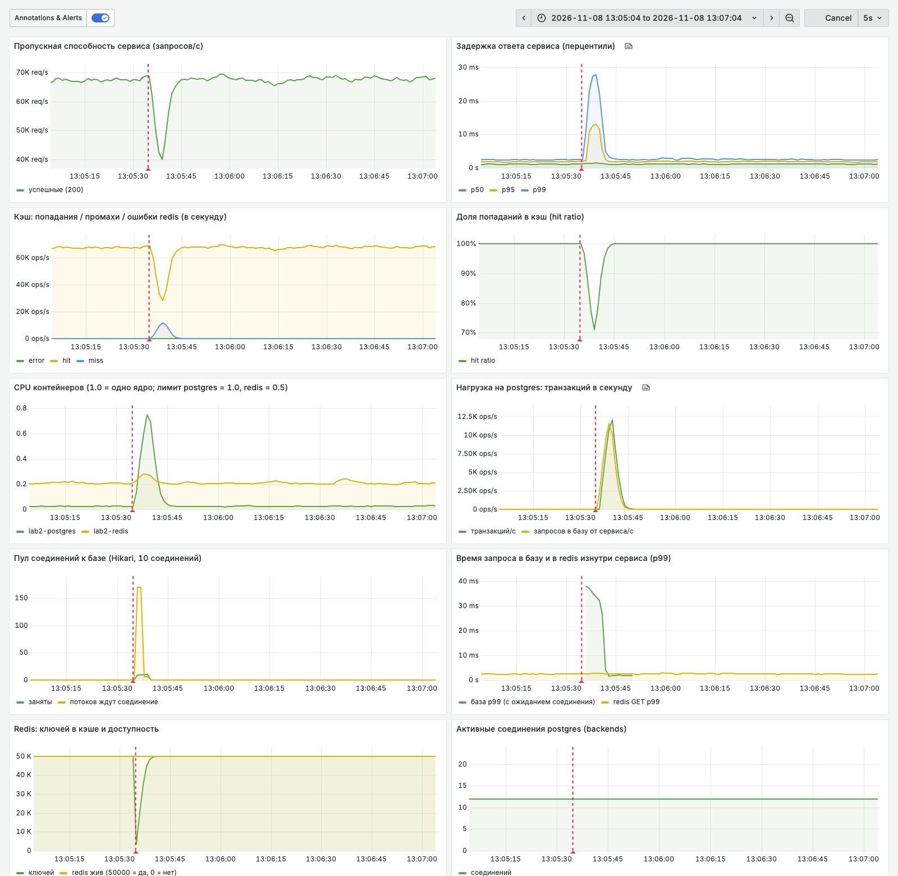

# Лабораторная работа №2

**Тема:** эмпирическое исследование влияния кэширования на производительность и деградацию распределённых систем.

**Объект:** трёхуровневая архитектура Client → App Server → RDBMS со слоем кэширования.

Код, запуск и инструкция к JMeter: [../code/README.md](../code/README.md). Описание паттерна Cache-aside: [cache-aside.md](cache-aside.md).

---

## Стенд

| Компонент | Где работает | Ресурсы |
|---|---|---|
| JMeter 5.6.3 | на компьютере | JVM 1 ГБ |
| Сервис: Kotlin, Spring Boot 4.1, JDBC, Lettuce | на компьютере | JVM 1 ГБ, Tomcat 200 потоков, пул соединений Hikari на 10 |
| Postgres 17 | Docker | **1 ядро**, 1 ГБ |
| Redis 8, без записи на диск | Docker | **0.5 ядра**, 256 МБ |
| Prometheus + Grafana + экспортеры | Docker | 0.2–0.5 ядра каждый |

Машина: Apple M4 Pro, 12 ядер, 24 ГБ, macOS 26, Docker Desktop.

Данные: таблица `users` на 50 000 строк, 9 колонок (id, username, email, first_name, last_name, city, birth_date, created_at, bio). Поиск идёт по первичному ключу.

## Методика

- **Нагрузка.** JMeter, 200 виртуальных пользователей. Каждый шлёт `GET /users/<случайный id от 1 до 50 000>` без пауз между запросами. Пользователи стартуют постепенно за 30 с, тест длится 10 минут.
- **Разгон не учитывается.** Первые 30 с исключены из итоговых цифр. В это время ещё не все пользователи запущены и не прогрета JVM.
- **Прогрев кэша.** Перед каждым прогоном с кэшем Redis очищается, затем по одному разу запрашивается каждый id (`warmup.jmx`). После прогрева в Redis 50 000 ключей.
- **Каждый прогон** запускается одним скриптом (`scripts/experiment.sh`) со свежим процессом сервиса.
- **Задержка** считается на стороне клиента, по сырым данным JMeter (каждый запрос записан в `result.jtl`). Перцентиль p99 = 12 мс значит: 99% запросов уложились в 12 мс. Средняя задержка скрывает «хвост» медленных запросов, поэтому основные метрики — перцентили.
- **Нагрузка на базу и кэш** берётся из Prometheus с шагом 1 с: CPU контейнеров, транзакции Postgres в секунду, ожидание соединения в пуле, доля попаданий в кэш.
- **Главный сигнал при отказе кэша** — пиковое число запросов к базе за секунду и p99, а не среднее и не доля попаданий. Этот подход взят из разбора cache stampede ([dev.to/ksankar](https://dev.to/ksankar/cache-stampede-a-primer-1l9b)).
- **Проверка согласованности цифр — закон Литтла:** пользователей в системе = пропускная способность × время ответа (N = X · R). Для каждого прогона произведение должно давать ≈200.

| Прогон | Что происходит |
|---|---|
| `nocache` | сервис всегда ходит в Postgres |
| `cache` | Redis + Cache-aside, кэш прогрет |
| `redis-stop` | как `cache`, на 180-й секунде `docker stop redis`, на 360-й `docker start redis` (Redis поднимается пустым) |
| `redis-flush` | как `cache`, на 180-й и 360-й секунде `redis-cli FLUSHALL` |

---

## Задание 1. Базовый сценарий

Эндпоинт `GET /users/{id}`: [UserController.kt](../code/app/src/main/kotlin/by/famcs/usersapi/UserController.kt). Запрос к базе: `select * from users where id = ?` через `JdbcClient`, без ORM: [UserRepository.kt](../code/app/src/main/kotlin/by/famcs/usersapi/UserRepository.kt). Кэш выключается переменной окружения `CACHE_ENABLED=false`.

## Задание 2. Нагрузочное тестирование без кэша (baseline)

| Метрика | Значение |
|---|---|
| Пропускная способность | **17 348 запросов/с** |
| Задержка p50 / p90 / p95 / p99 / p99.9 | 8 / 28 / 37 / 55 / 82 мс |
| Средняя / максимальная задержка | 11.5 / 680 мс |
| Ошибки | 0 |
| CPU Postgres | **1.00 ядра из 1.00** |
| Транзакций Postgres в секунду | 17 354 |
| Потоков, ждущих соединение с базой (в среднем) | 187 из 200 |

Узкое место — база: Postgres загружен на весь свой лимит (одно ядро), а почти все потоки сервиса стоят в очереди за одним из 10 соединений.

Закон Литтла: 17 348 · 0.0115 с ≈ 200 ✓.

## Задание 3. Слой кэширования

Cache-aside реализован вручную в [UserService.kt](../code/app/src/main/kotlin/by/famcs/usersapi/UserService.kt):
- ключ `user:<id>`, значение — JSON пользователя;
- TTL 30 минут ±10%;
- если Redis не ответил за 200 мс, запрос идёт прямо в базу.

Подробно о паттерне: [cache-aside.md](cache-aside.md).

## Задание 4. Сравнение: без кэша / с кэшем

| Метрика | Без кэша | С кэшем | Разница |
|---|---|---|---|
| Пропускная способность, запросов/с | 17 348 | 70 719 | ×4.1 |
| Средняя задержка, мс | 11.5 | 2.8 | −76% |
| p50, мс | 8 | 3 | −63% |
| p90, мс | 28 | 4 | −86% |
| p95, мс | 37 | 4 | −89% |
| p99, мс | 55 | 6 | −89% |
| p99.9, мс | 82 | 8 | −90% |
| Максимум, мс | 680 | 88 | |
| Ошибки | 0 | 0 | |
| Доля попаданий в кэш | — | 100% | |
| CPU Postgres, ядер | 1.00 | 0.02 | в 50 раз меньше |
| Транзакций Postgres/с | 17 354 | 29 (фон: экспортер метрик) | |
| CPU Redis, ядер | 0 | 0.18 из 0.5 | |
| CPU сервиса, ядер | 2.1 | 5.5 | |
| Закон Литтла, N = X · R | 200 | 199 | ✓ |

На графике перцентилей кривая FLUSHALL совпадает с кривой «с кэшем» до p99.5 и расходится только в «хвосте» (p99.9 и выше). Две очистки кэша по 3–4 секунды из 10 минут прогона заметны только в самых медленных 0.1% запросов.

С кэшем база почти не нагружена. Узким местом стала сама машина: JMeter и сервис вместе занимают ~11.6 из 12 ядер компьютера, а Redis использует меньше половины своего лимита. Значит, ~70 тыс. запросов/с — это предел стенда, а не кэша.

---

## Задание 5. Отказ кэша (cache miss storm)

### 5.1. Redis выключен: `docker stop redis` на 3 минуты

| Фаза | Запросов/с | p50, мс | p99, мс | max, мс | Ошибки | CPU Postgres | Запросов в базу/с |
|---|---|---|---|---|---|---|---|
| до отказа | 62 989 | 3 | 7 | 32 | 0 | 0.03 | 0 |
| **Redis выключен** | **988** | **205** | **217** | 264 | 0 | 0.16 | 990 |
| после включения (пустой кэш) | 67 942 | 3 | 6 | 246 | 0 | 0.04 (пик 0.78) | пик 11 914 |

Что произошло:

1. **Ошибок нет**: сервис при сбое Redis идёт прямо в базу.
2. **Пропускная способность упала в 64 раза.** Каждый запрос ждал полный таймаут Redis (200 мс) и только потом уходил в базу. Клиент Lettuce, потеряв соединение, переподключается со всё большей паузой (до 30 с), а команды тем временем ставит в очередь. Каждая команда ждёт до таймаута. Это видно в логе сервиса (`results/redis-stop/app.log`).
3. **База при этом не перегружена** (0.16 ядра, ~1 000 запросов/с). Систему ограничила не база, а ожидание недоступного Redis. Закон Литтла: 200 / 0.205 с = 975 запросов/с — совпадает с измеренными 988.
4. **Таймаут здесь — главный параметр.** С таймаутом Lettuce по умолчанию (60 с) пропускная способность была бы 200 / 60 ≈ 3 запроса/с, то есть фактически полный отказ сервиса.
5. **Redis включился пустым.** Это шторм промахов: 11.9 тыс. запросов/с в базу, CPU Postgres 0.78. Пропускная способность вернулась к прежней за **7.7 с** после `docker start`.

### 5.2. `FLUSHALL` на 3-й и 6-й минуте (Redis жив, но пуст)

| Событие | Запросов/с до | Мин. запросов/с за 1 с | Макс. p99 за 1 с, мс | Пик запросов в базу/с | Пик CPU Postgres | Восстановление |
|---|---|---|---|---|---|---|
| FLUSHALL #1 | 67 207 | 28 889 | 30 | 11 607 | 0.74 | 2.9 с |
| FLUSHALL #2 | 67 207 | 22 626 | 41 | 11 188 | 0.77 | 3.7 с |

| Фаза | Запросов/с | p50 | p95 | p99 | p99.9 | Ждут соединение с базой (ср.) |
|---|---|---|---|---|---|---|
| до FLUSHALL | 67 513 | 3 | 5 | 6 | 8 | 0 |
| 30 с после FLUSHALL #1 | 63 873 | 3 | 5 | 10 | 25 | 11.7 (пик ~170) |
| 30 с после FLUSHALL #2 | 63 456 | 3 | 5 | 11 | 30 | 16.5 |

Что произошло:

1. В первую секунду после очистки каждый запрос — промах. Нагрузка на базу растёт с 0 до ~11.6 тыс. запросов/с, пул соединений забивается (до ~170 ожидающих потоков), p99 вырастает в 5–7 раз.
2. Каждый промах кладёт ключ обратно в кэш, поэтому доля попаданий быстро растёт. Через 3–4 с кэш снова почти полный, и всё возвращается к норме. Обе очистки дали одинаковую картину, то есть результат воспроизводится.
3. Шторм короткий, потому что ключей мало (50 000), а база успевает отдавать ~17 тыс. строк/с. Наполнение кэша описывается формулой «доля в кэше = 1 − e^(−n/N)», где n — число промахов, N — число ключей. Время до наполнения на 95% ≈ 3 · N / (скорость базы).

### 5.3. Остановка Redis против FLUSHALL

| | `docker stop` | `FLUSHALL` |
|---|---|---|
| Ошибки клиента | 0 | 0 |
| Падение пропускной способности | ×64, держится всё время отказа | в ×2–3 на 1–2 с |
| Узкое место | ожидание таймаута Redis | база и пул соединений |
| Нагрузка на базу | ~1 000 запросов/с (база простаивает) | пик ~11.6 тыс. запросов/с, CPU до 0.77 |
| Восстановление | ~8 с после включения (переподключение + наполнение кэша) | 3–4 с |

Один и тот же код ведёт себя по-разному. Пустой, но живой кэш почти незаметен. А «мёртвый» кэш оказывается хуже, чем отсутствие кэша вообще: 988 против 17 348 запросов/с. Причина — ожидание таймаута на каждом запросе.

---

## Задание 6. Почему кэширование критично в высоконагруженных системах

1. **Кэш переносит нагрузку с самого дорогого ресурса.** База (1 ядро) без кэша упирается в ~17 тыс. запросов/с. С кэшем при той же базе сервис держит ~70 тыс. запросов/с, а база загружена на 2–3%. Нагрузка на базу = (1 − доля попаданий) · поток запросов. При 99% попаданий база видит 1% запросов, поэтому одна и та же база выдерживает поток в десятки раз больше.
2. **Кэш срезает «хвост» задержек.** p99 упал с 55 до 6 мс, p99.9 — с 82 до 8 мс. В высоконагруженной системе пользовательская страница собирается из многих вызовов, и её скорость определяет самый медленный, то есть именно хвост.
3. **Но после внедрения кэша система от него зависит.** Мощность базы теперь рассчитана только на промахи. В нашем стенде без кэша база выдерживает ~17 тыс. запросов/с, а приходит ~70 тыс. Значит, при отказе кэша база не способна обслужить весь поток.
4. **В реальной системе отказ будет хуже, чем в лабе.** JMeter работает по «закрытой» модели: пользователь шлёт следующий запрос только после ответа. Когда сервис тормозит, нагрузка сама уменьшается. Реальные клиенты приходят независимо от того, тормозит ли сервис. Если приходит 70 тыс. запросов/с, а обслуживается 17 тыс., очередь растёт на ~53 тыс. запросов каждую секунду. Дальше: таймауты, повторные запросы клиентов, ещё больше нагрузки. Это и есть **каскадный отказ**.
5. **Время «холодного» старта растёт с объёмом данных.** У нас 50 000 ключей наполнились за 3–8 с. Для сервиса из лабы 1 (50 млн пользователей) при той же скорости базы: 3 · 50 000 000 / 17 000 ≈ **2.5 часа** работы базы на пределе.
6. **Отсюда обязательные меры** (подробнее в [cache-aside.md](cache-aside.md)):
   - короткий таймаут на кэш;
   - «предохранитель» (circuit breaker), который при отказе Redis сразу идёт в базу, без ожидания;
   - прогрев кэша после перезапуска;
   - разброс TTL;
   - объединение одинаковых промахов (single-flight);
   - запас мощности базы на время восстановления кэша.

---

## Ограничения эксперимента

- **JMeter и сервис работают на одной машине.** С кэшем они занимают почти все 12 ядер, поэтому любая фоновая программа заметно снижает пропускную способность. Две первые попытки прогона «с кэшем» дали 48 и 59 тыс. запросов/с с провалами до 16–25 тыс. Причина — фоновые процессы (VPN-клиент и др.). После их закрытия прогон дал ровные 70.7 тыс. Неудачные попытки лежат в `results/cache-try1` и `results/cache-before-1414`, в таблицы не вошли.
- **Повторяемость.** Два 10-минутных прогона без кэша дали 15 430 и 17 114 запросов/с (разброс ~10%).
- **Задержка записывается JMeter в целых миллисекундах**, поэтому значения 2–6 мс на графиках идут «ступеньками».
- **Нагрузка на базу из Prometheus** сглажена окном 5 с, поэтому настоящий секундный пик чуть выше показанного.

## Выводы

1. Без кэша сервис упирается в базу: ~17 тыс. запросов/с, p99 = 55 мс, CPU Postgres 100% от лимита.
2. Cache-aside на Redis увеличил пропускную способность в ×4.1 (17.3 → 70.7 тыс. запросов/с) и снизил p99 в ×9 (55 → 6 мс), а нагрузку на базу почти до нуля. Предел сместился с базы на CPU машины.
3. `FLUSHALL` вызывает короткий шторм промахов: всплеск ~11.6 тыс. запросов/с в базу, p99 до 30–41 мс, восстановление за 3–4 с.
4. Остановка Redis даже с запасным путём в базу снизила пропускную способность в 64 раза из-за ожидания таймаута на каждом запросе. Отказ кэша опаснее его опустошения, а таймаут и стратегия переподключения клиента важнее самого запасного пути.
5. Система с кэшем рассчитана на высокую долю попаданий. Без мер защиты отказ кэша на реальном масштабе ведёт к каскадному отказу базы.
